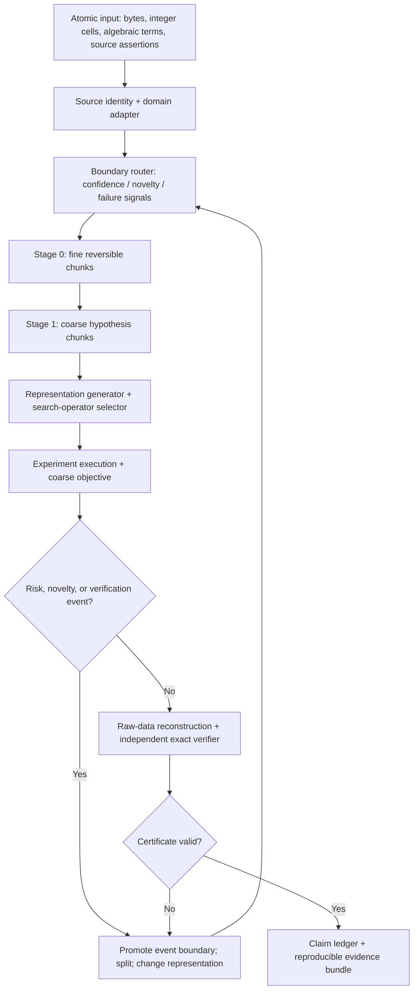

# NIGHTFALL Discovery Engine — adaptive abstraction integration

**Design revision:** 2026-10-28 | **Status:** architecture specification plus independently tested, non-ML segmentation prototype. **Research lead:** Devin J. Wright.

## Summary

NIGHTFALL's Discovery Engine already has five intended interfaces: define a mathematical problem; generate and mutate candidate representations; choose reusable search operators; execute and compare experiments; certify and package results. The Cartesia research suggests one additional shared control variable: **the resolution and boundaries of a representation**.

A candidate now includes an abstraction hierarchy and a reversible path to its atomic evidence. Search can move up to coarse blocks to identify structural opportunities, then descend to the exact witness at the first uncertainty, boundary event, or verifier objection. This is a *proposal and executable baseline*, not a reproduction of Cartesia's trained H-Net.

## Design invariants

1. **Representation before computation.** The primary record is a byte-exact source, a domain-native atom stream, and a manifest. A canonical source SHA-256 survives every hierarchy change. The engine may choose a new interpretation; it never rewrites the source silently.
2. **Resolution is an experimental control.** Search candidate = (construction, representation, resolution policy, operator, budget, lineage). Candidate discovery, representation mutability, and operator search are independent coordinates.
3. **No compression of mathematical obligations.** Coarse blocks may suggest candidates and yield provable lower/upper bounds, yet all final mathematical scores are reconstructed from original coordinates and checked by an independent checker.
4. **Evidence boundaries override the router.** Any lemma quantifier, contradiction witness, inequality crossing, source/citation boundary, trust boundary, or failed verifier span is forced to remain inspectable at each coarse level.
5. **Proof statuses attach to source + conditions + verifier.** A new hierarchy invalidates any *representation-specific* cached claim. Exact results whose source bytes and mathematical checker remain identical retain the original claim status.
6. **Discoveries compound.** Store the successful granularity/operator combination, the rejected coarse projections, the failure offsets, transfer conditions, and the counterexample class, avoiding repetitive failed search.

## Five-stage pipeline with adaptive resolution

These two stages are structurally inspired by learned hierarchical compression; the initial implementation uses externally supplied boundary scores and explicit forced splits. Training a learned router remains a separate experimental phase.

## Architectural components

| Component | New responsibility | Required observable output |
| --- | --- | --- |
| Atomic adapter | Expose genuine primitives without speculative preprocessing: array cells, coefficient sequences, symbol positions, source spans, byte ranges | Source hash, atom offsets, reversible decode |
| Dynamic router | Assign proposed boundaries given context, search objective, novelty, uncertainty, cost and prior failures | Model/policy version; boundary scores; explanation; measured overhead |
| Two-stage hierarchy | Fine structural chunks, then coarse research motifs; support resegmentation after a failure | Parent-child coverage, atom spans, original hash, compression ratio |
| Representation search | Evaluate different coordinate systems and **chunk boundaries** as distinct candidate hypotheses | Candidate ID, parent, transformation contract, reversible lifting |
| Operator portfolio | Pair operator families with representations whose granularities suit them | Contact splitting, block mixing, lattice decoding, evidence rebinding |
| Verification cascade | Cheap screening; exact raw replay; adversarial checker; source-theorem dependency audit | Raw witness, independent result, mismatch trace, versioned status |
| Experiment memory | Update boundary policy from *out-of-sample* successes and failures | Outcome by representation/operator/domain, budget and dataset split |
| Packaging | Ship runnable checker and manifest alongside the input record | Original atoms, hierarchy trace, checker commands, SHA-256 |

## Domain adapters

**Erdős overlap.** Atomic units are signed-shift witness cells, rational endpoints, and exact contact events. Fine chunks retain local support/boundary changes; coarse chunks represent entire donor blocks and persistent contact clusters. A coarse score guides search only. The final continuum overlap maximum is always reconstructed with the complete signed-shift/event-envelope verifier. Promote any newly active shift into a hard boundary and revisit the structure.

**Finite-field phase retrieval.** Atomic units are rows of the sensing matrix, individual phase constraints, direction vectors and short-lattice relations. Fine chunks group directions with shared elimination structure; coarse chunks represent candidate sublattices/collision classes. A candidate list size is distinct from full recovery. Certify with original field arithmetic, exhaustive survivor testing where claimed, and recorded source span-lemma dependencies.

**SourceBound / agent safety.** Atomic units are page bytes, claims, citation spans and browser-visible evidence. Fine chunks retain assertion boundaries and provenance; coarse chunks group corroborating assertions. If two assertions collapse into an abstraction that loses attribution, force a split. Only the exact source-to-claim rebinding checker can approve publication. A segmentation with plausible semantic alignment and wrong source lineage is a failed representation.

**Proof search and coding.** Atomic units are definitions, hypothesis scopes, operations, exact equations, and proof obligations. Failure counterexamples trigger local de-chunking. Learned patterns may suggest reusable lemmas; certification still travels with each claimed lemma.

## Key lesson from Cartesia's two-part series

1. **Fixed pretokenization introduces hidden priors.** NIGHTFALL must visibly record any preprocessing that could remove a counterexample, smooth a sharp contact, collapse proof assumptions, or lose source attribution.
2. **Compression and transfer need separate metrics.** A smaller representation can run faster while performing worse on held-out research problems. Record both the compute-to-internal-objective curve and the internal-objective-to-certified-result curve.
3. **Context changes the right unit.** Recurring motifs may compress in repeated runs; unexpected boundary cases may need a finer atomization even after a model has learned a stable chunk.
4. **End-to-end training deserves a real ablation.** Compare fixed structural segmentation, entropy/uncertainty heuristic, frozen learned router, jointly trained router, and atomic baseline. The current lightweight prototype belongs only to the heuristic/interchangeable-policy tier.
5. **The prompt-boundary issue generalizes.** Probabilities assigned to candidate abstractions are segmentation-dependent. Compare the same raw outcome after summing segmentation paths where applicable, or score only the reconstructed raw outcome. Never compare incompatible canonical chunk scores as though they were exact probabilities.

## Evaluation contract — proof-sensitive rather than language-model perplexity

The project metric is **compute per valid independently replayable discovery**, with a common frozen problem suite and compute budget. Log:

- raw bytes/atoms processed, per-stage compression ratio, wall time, compute, and independent checker cost;
- candidate feasibility rate, certified gain and comparison baseline, recall of known counterexamples, false-promotion rate;
- transfer to unseen domains/operators under matched discovery budgets;
- under identical raw source and objective, sensitivity of final outcomes to shifted chunk boundaries;
- how often forced resegmentation exposes a previously hidden claim error.

Prefer a result at **two domains** before claiming cross-domain benefit: begin with minimum overlap plus SourceBound or finite-field retrieval. Use blind holdouts, at least one adversarial boundary suite, and negative controls. Train/validation splits, compute matching and failure logs are part of each release.

## Evidence status and source attribution

The Cartesia results are external empirical observations in language modeling and biology, not experimental results obtained by NIGHTFALL. Approximate reported Cartesia multipliers include ~1.28x compute-to-validation, ~2.06x compute-to-downstream in the controlled one-stage ladder and >10x stated gains under the separate two-stage SmolLM3 comparison. They cannot be transferred numerically to mathematical research search.

Sources:
- Cartesia Research, [From Tokens to Bytes I: Scaling Hierarchical Networks](https://www.cartesia.ai/blog/from-tokens-to-bytes-part-1), 28 Oct 2026.
- Cartesia Research, [From Tokens to Bytes II: Learning from Raw Data](https://www.cartesia.ai/blog/from-tokens-to-bytes-part-2), 28 Oct 2026.

**Originality boundary:** Dynamic chunking/H-Nets, entropy boundaries and end-to-end boundary learning belong to prior architecture research. NIGHTFALL's research hypothesis is whether **failure-driven, reversible, proof-preserving adaptive abstraction** improves the number of *valid certified discoveries* for a fixed search budget. This is a testable proposal, with no measured superiority currently claimed.

## Implementation stages

1. **Implemented baseline:** byte-exact two-stage segmentation; contextual score injection; forced preservation of evidence boundaries; lossless source regeneration; hash checks; segmentation-invariance and adversarial corruption tests. See [adaptive_resolution.py](adaptive_resolution.py), [test_adaptive_resolution.py](test_adaptive_resolution.py).
2. **Next implementation:** wrap the already working exact overlap lab's source atoms; add candidate/version/lineage JSON and event-driven resegmentation.
3. **Second-domain transfer:** wrap SourceBound's assertion spans, plus fixed-source rebinding verifier; run seeded counterexample tasks.
4. **Learned router:** define an end-to-end objective over valid certified discoveries, use test-time feedback strictly on exploration splits; compare against frozen and heuristic router policies at matched compute. This remains a research task, with no existing trained model.

## Executed Stage 2: downstream-supervised policy selection

The workbench contains `granularity_study.py`, with independent `granularity_oracle.py` as the exact atomic verification path. Candidate state and chunk policy are independent experimental coordinates. Frozen fixed, event-adaptive heuristic, atomic and training-selected policies see identical candidate pools and exact verification budgets.

The policy selector searches a grid of 18 configurations of max fine span, edge-trigger value, and max coarse children. It optimizes exact downstream training gains, with coarse-operation cost only as a tie break. The held-out split uses independent deterministic seeds and is excluded from model choice. This is a discrete supervised control baseline, not a neural H-Net recreation.

The pre-registered report includes: source SHA-256 digests by split; raw objective values; exact budget; per-policy certified proxy gains; rejected proposed source spans; compression ratios; coarse scoring-operation totals; selected parameters; and explicit domain-transfer limitations. Performance gains, if any, belong to this restricted synthetic suite pending additional splits, confidence intervals, compute accounting and independent execution. The immutable source/trust boundaries and source-domain checker decisions are evaluated from original atoms after candidate selection.
